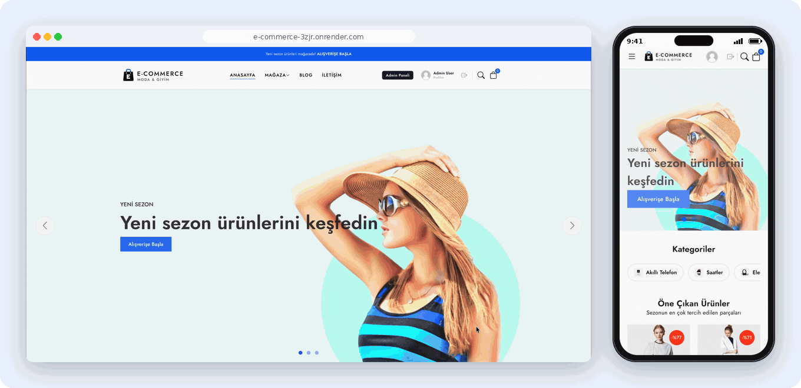
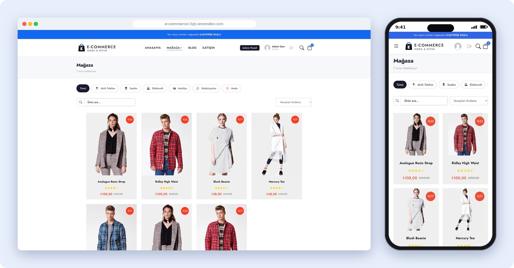
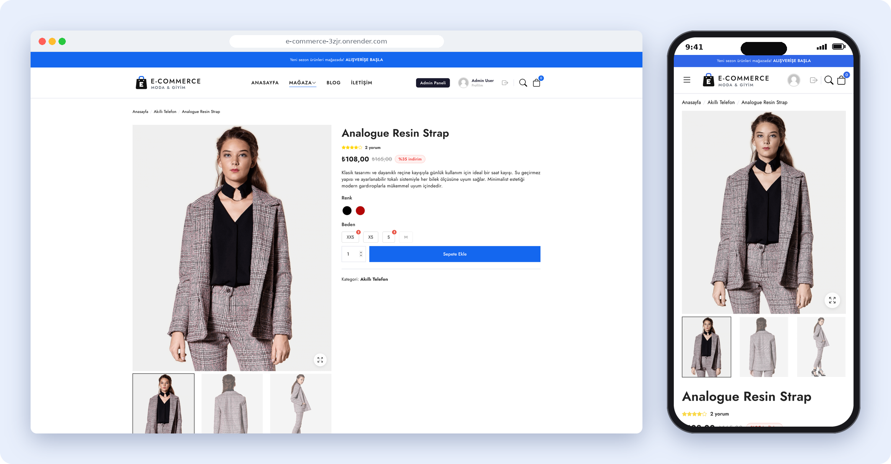
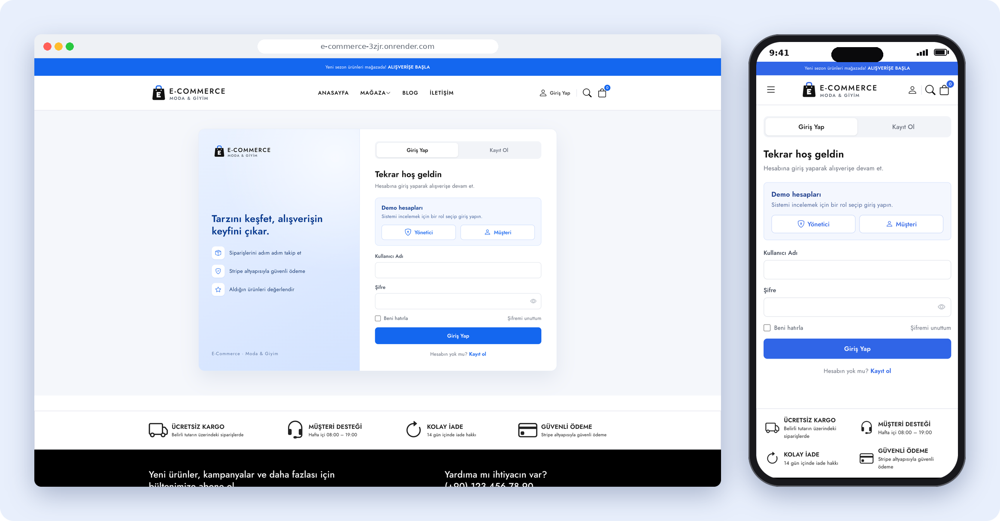
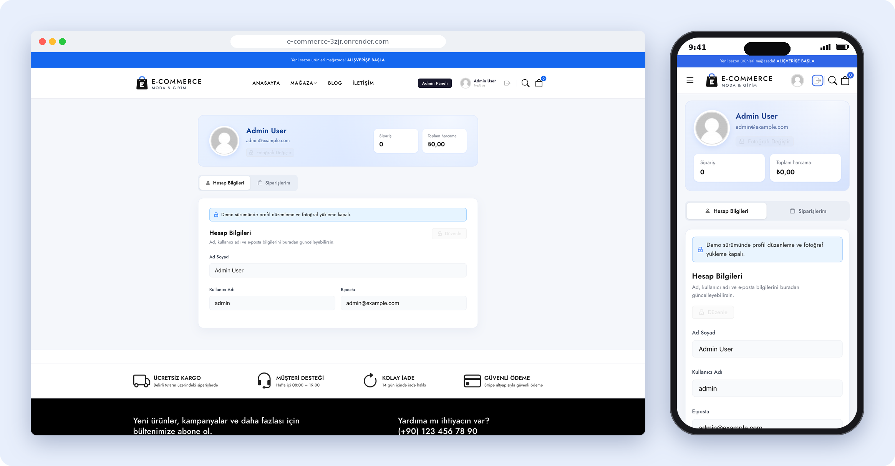
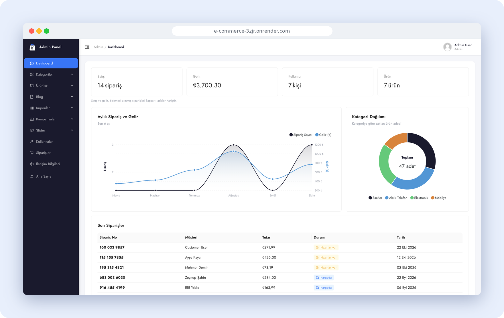
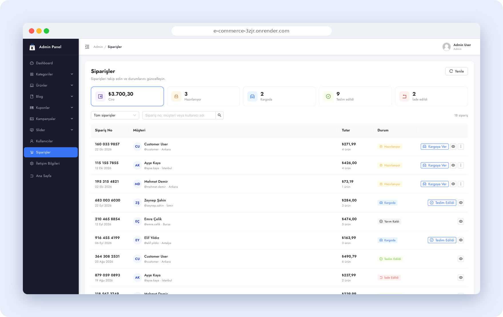

# 🛍️ E-Commerce | Moda & Giyim
 
[](https://github.com/M-Fatih00/e-commerce/actions/workflows/ci.yml)


 
<!-- docs/screenshots/showcase.gif: Masaüstü ve mobil anasayfa kaydı yan yana, tek görsel -->
<p align="center">
  
</p>
**ASP.NET Core Web API** ve **React + TypeScript** ile geliştirilmiş, uçtan uca bir e-ticaret platformu. Kimlik doğrulama, Stripe ile ödeme, beden bazlı stok yönetimi, yönetilebilir içerikli admin paneli, otomatik testler, CI ve yük testleriyle birlikte gelir.
 
🔗 **Canlı Demo:** [e-commerce-3zjr.onrender.com](https://e-commerce-3zjr.onrender.com)
 
> ⏳ Ücretsiz barındırma kullanıldığı için site uzun süre ziyaret edilmediğinde uyku moduna geçer; ilk açılış 30-50 saniye sürebilir. Demo veritabanı her yeniden başlatmada sıfırlanır.
 
---
 
## 📋 İçindekiler
 
- [v2'de Neler Değişti](#-v2de-neler-değişti)
- [Özellikler](#-özellikler)
- [Demo'yu Deneyin](#-demoyu-deneyin)
- [Teknoloji Yığını](#-teknoloji-yığını)
- [Güvenlik](#-güvenlik)
- [Testler ve CI](#-testler-ve-ci)
- [Yük Testi](#-yük-testi)
- [Ekran Görüntüleri](#-ekran-görüntüleri)
- [Kurulum](#-kurulum)
- [Proje Yapısı](#-proje-yapısı)
- [Bilinen Sınırlamalar ve Yol Haritası](#-bilinen-sınırlamalar-ve-yol-haritası)
---
 
## 🆕 v2'de Neler Değişti
 
Projenin ilk sürümünü yayınladıktan sonra, onu gerçek bir ürün gibi baştan sona yeniden ele aldım: tasarımı, güvenliği, test edilebilirliği ve dağıtım sürecini iyileştirdim.
 
**Tasarım ve kullanıcı deneyimi**
- Yeni marka kimliği: logo, favicon seti ve uygulama ikonları
- İçerik yüklenirken sayfanın zıplamasını önleyen **skeleton** yükleme durumları (anasayfa, mağaza, blog)
- Yeniden tasarlanan **giriş / kayıt** sayfası ve tek tıkla doldurulan **demo hesap** seçimi
- Yeniden tasarlanan **profil** sayfası: sipariş özetleri, harcama istatistikleri, animasyonlu sekmeler
- Ürün detayında **tam ekran görsel önizleme** (yakınlaştırma, galeride gezinme) ve geçiş animasyonları
- Mobilde yana kaydırmalı kampanya ve blog kartları; tüm sayfalarda mobil düzen iyileştirmeleri
- Şablondan kalan tüm metinler temizlendi, arayüz tamamen Türkçeleştirildi
- Mağaza filtreleri adres çubuğuyla senkronize: kategori linkleri paylaşılabilir ve geri tuşuyla çalışır
**Yeni özellikler**
- Admin panelinden **slider yönetimi**: görsel yükleme, sıralama, aktif/pasif, her slayta özel başlık ve buton, canlı önizleme
- Admin panelinden yönetilen **iletişim bilgileri**
- Okunması kolay **10 haneli sipariş numaraları** (`482 715 9360`)
- Sipariş durumları gerçek projelerdeki gibi: *Ödeme Bekleniyor → Hazırlanıyor → Kargoda → Teslim Edildi*, iptalde Stripe üzerinden otomatik iade
- **Demo modu**: gerçekçi demo verisi (müşteriler, siparişler, yorumlar, profil resimleri) ve sunucu tarafında kilitlenen yazma işlemleri
**Kalite, güvenlik ve dağıtım**
- **xUnit** test projesi: birim testleri ve API yetkilendirme testleri (34 test)
- **GitHub Actions** ile her PR'da otomatik build ve test
- Güvenlik incelemesi: paket açıkları kapatıldı, demo kilitleri sunucu tarafına taşındı, HSTS eklendi
- Çok aşamalı **Docker** build'i ile frontend ve backend tek imajda; önbellek stratejisi ile deploy sonrası eski dosya sorunları çözüldü
- **Yük testleri** yenilendi: 2.500+ eşzamanlı kullanıcıya kadar sıfır hata (detaylar aşağıda)
---
 
## ✨ Özellikler
 
### 🛒 Müşteri Tarafı
- **Vitrin:** Yönetilebilir slider, kategoriler, öne çıkan ürünler, kampanyalar ve blog
- **Mağaza:** Kategori filtresi, sıralama (fiyat, indirim) ve arama; filtreler adres çubuğunda tutulur
- **Ürün detayı:** Çoklu görsel galerisi ve tam ekran önizleme, renk ve beden seçimi
- **Beden bazlı stok:** Her bedenin stoğu ayrı takip edilir; tükenen beden seçilemez, son birkaç ürün uyarısı gösterilir
- **Sepet:** Adet yönetimi, stok aşımı engeli, kupon uygulama
- **Kargo:** ₺1.000 üzeri siparişlerde ücretsiz kargo, isteğe bağlı hızlı kargo
- **Ödeme:** Stripe Checkout ile güvenli ödeme
- **Profil:** Bilgi güncelleme, profil fotoğrafı, sipariş geçmişi ve harcama özeti
- **Yorum ve puanlama:** Giriş yapmış kullanıcılar ürün başına bir yorum yapabilir, kendi yorumunu düzenleyip silebilir; yorum sahiplerinin soyadı gizlenir (`Ayşe K.`)
- **Anlık ürün arama**, blog ve harita içeren iletişim sayfası
### 🛠️ Admin Paneli
- **Dashboard:** Satış, gelir, kullanıcı ve ürün sayıları; son 6 ayın sipariş/gelir grafiği; kategori bazlı satış dağılımı
- **Ürün yönetimi:** Görseller, renkler, bedenler ve beden bazlı stok
- **Kategori, kupon ve kampanya yönetimi**
- **Blog yönetimi:** Zengin metin editörü (TipTap); içerik sunucuda temizlenerek saklanır
- **Slider yönetimi:** Sıralama, aktif/pasif, slayt başlıkları ve buton linkleri, canlı önizleme
- **Sipariş yönetimi:** Tüm siparişler, arama, durum akışı ve iade ile iptal
- **Kullanıcı yönetimi:** Rol atama ve kullanıcı silme (aşağıdaki güvenlik kurallarıyla)
- **Yorum moderasyonu:** Admin, uygunsuz yorumları silebilir
- **İletişim bilgileri:** Mağaza e-postası, adres ve çalışma saatleri
### 📱 Responsive Tasarım
Masaüstü, tablet ve telefon için ayrı ayrı düzenlenmiş arayüz.
 
---
 
## 🎯 Demo'yu Deneyin
 
Giriş sayfasındaki **Demo hesapları** kutusundan **Yönetici** veya **Müşteri** rolünü seçmeniz yeterli; bilgiler otomatik dolar.
 
- Demo modunda ürün, kategori, blog gibi içerikleri değiştiren işlemler **sunucu tarafında kilitlidir**. Formları ve sayfaları inceleyebilir, ancak kaydedemezsiniz. Bu sayede site her ziyaretçi için düzgün kalır.
- Ödeme Stripe **test modunda** çalışır. Test kartı: `4242 4242 4242 4242`, ileri bir tarih ve herhangi bir CVC.
---
 
## 🧰 Teknoloji Yığını
 
| Katman | Teknolojiler |
|---|---|
| **Frontend** | React, TypeScript, Vite, Redux Toolkit, React Router, Ant Design, TipTap, Axios |
| **Backend** | ASP.NET Core Web API (.NET 9), Entity Framework Core, ASP.NET Core Identity, JWT |
| **Veritabanı** | SQLite |
| **Ödeme ve e-posta** | Stripe Checkout, MailKit (SMTP) |
| **Test** | xUnit, WebApplicationFactory (API testleri), k6 (yük testi) |
| **DevOps** | Docker (çok aşamalı build), GitHub Actions, Render |
 
---
 
## 🔒 Güvenlik
 
### Kimlik doğrulama ve oturum
- JWT, `localStorage` yerine **HttpOnly, Secure, SameSite** bir cookie'de saklanır; JavaScript token'a erişemez.
- Her istekte kullanıcının **güvenlik damgası** doğrulanır: rolü değişen ya da silinen kullanıcının eski token'ı anında geçersiz olur.
- Giriş, kayıt, kupon, yorum ve iletişim formu için **IP bazlı istek sınırı**; art arda hatalı girişte hesap kilitlenir.
- Kullanıcı yokken ve şifre yanlışken aynı hata mesajı döner (kullanıcı adı tahmini zorlaşır).
### Yetkilendirme
- Müşteriler yalnızca kendi siparişlerini, sepetini ve yorumlarını görebilir ve değiştirebilir; bu kontrol sunucuda yapılır.
- Bir kullanıcının rolünü değiştirmek için işlemi yapan **adminin kendi şifresini tekrar girmesi** gerekir.
- **Son admin korunur:** Sistemdeki son adminin yetkisi kaldırılamaz, hesabı silinemez; admin kendi hesabını silemez.
- Demo modu kilitleri yalnızca arayüzde değil, **sunucu tarafında** bir filtreyle uygulanır.
### Ödeme
- Sipariş tutarı her zaman **sunucuda, veritabanındaki fiyatlarla** hesaplanır; tarayıcıdan gelen fiyata güvenilmez.
- Stripe dönüşünde ödeme durumu, tutar, para birimi ve sipariş eşleşmesi Stripe API'sinden doğrulanır.
- Aynı ödeme bildirimi iki kez işlenemez; stok mükerrer düşmez. Ödeme sırasında stok tükenirse ödeme otomatik iade edilir.
### Girdi ve dosyalar
- Blog içeriği hem kaydederken hem okurken **HTML temizleyiciden** geçer (izinli etiket listesi).
- Yüklenen görsellerin türü, uzantıya değil **dosyanın içeriğine (magic bytes)** bakılarak doğrulanır; boyut sınırı 5 MB, dosya adları rastgele üretilir.
- Slider buton linkleri yalnızca site içi adresleri kabul eder (açık yönlendirme engeli).
- İletişim formunda e-posta başlık enjeksiyonu engellenir, kullanıcı girdisi HTML olarak kodlanır.
### Altyapı
- HSTS, `X-Frame-Options`, `X-Content-Type-Options`, `Referrer-Policy` ve `Permissions-Policy` başlıkları
- Canlı ortamda hata detayları (stack trace) dışarı sızdırılmaz.
- Gizli anahtarlar ortam değişkenlerinde tutulur, repoda gizli bilgi yoktur.
- `dotnet list package --vulnerable` ve `npm audit` ile paket taraması yapıldı, açıklar kapatıldı.
---
 
## ✅ Testler ve CI
 
```bash
dotnet test
```
 
- **Birim testleri:** Sipariş numarası üretimi, görsel doğrulama (gerçek resim / sahte dosya / boyut sınırı), kargo ücreti kuralları, slider link doğrulaması, demo modu filtresi
- **API testleri:** Uygulama geçici bir veritabanıyla gerçekten ayağa kaldırılır ve HTTP istekleriyle test edilir: giriş yapmadan admin uç noktalarına erişilemediği, müşterinin admin işlemi yapamadığı, demo modunda adminin bile veri silemediği doğrulanır.
- **GitHub Actions:** Her pull request'te backend build + testler ve frontend build otomatik çalışır.
---
 
## 🔬 Yük Testi
 
Gerçek kullanıcı akışı [k6](https://k6.io) ile simüle edildi: **kayıt → giriş → ürün listesi → ürün detayı → sepete ekleme.** Her sanal kullanıcı adımlar arasında gerçek bir kullanıcı gibi 1-2 saniye bekler.
 
| Senaryo | Eşzamanlı kullanıcı | Toplam istek | Hata oranı | Medyan yanıt | p95 yanıt |
|---|---:|---:|---:|---:|---:|
| Normal yük | 200 | 25.720 | **%0** | 1,6 ms | 40 ms |
| Stres | 1.000 | 86.970 | **%0** | 314 ms | 4,2 sn |
| Kırılma noktası | ~2.550 | 168.940 | **%0** | 792 ms | 10,2 sn |
 
**Sonuçların yorumu**
- 200 eşzamanlı kullanıcıya kadar isteklerin %95'i **40 ms'nin altında** yanıtlanıyor.
- Kırılma noktası testinde kullanıcı sayısı 3.000'e kadar artırıldı; test, p95 yanıt süresi 10 saniyeyi geçtiğinde (~2.550 kullanıcı) durduruldu. Bu noktaya kadar **168.940 isteğin hiçbiri başarısız olmadı**: sistem yük altında yavaşladı ama çökmedi ve veri kaybetmedi.
- Sistem saniyede ~330 istekte doygunluğa ulaşıyor. Darboğazın üç kaynağı var:
  1. Şifre işlemleri (kayıt/giriş) kasıtlı olarak yavaş çalışan bir algoritma kullanır ve işlemciyi yorar.
  2. SQLite aynı anda tek bir yazma işlemine izin verir; kayıt ve sepet işlemleri sıraya girer.
  3. k6 ve uygulama aynı bilgisayarda çalıştığı için işlemciyi paylaşır.
**Test ortamı:** MacBook Pro üzerinde yerel çalıştırma, Release build, SQLite. Testler sırasında istek sınırları kapatıldı. Stripe'a giden sipariş adımı, üçüncü taraf servisin hızını değil uygulamanın kendisini ölçmek için hariç tutuldu (`-e WITH_ORDER=true` ile açılabilir).
 
```bash
k6 run ecommerce-load-test.js                          # normal yük
k6 run -e TEST_TYPE=stress ecommerce-load-test.js      # 1.000 kullanıcı
k6 run -e TEST_TYPE=breakpoint ecommerce-load-test.js  # kırılma noktası
```
 
---
 
## 📸 Ekran Görüntüleri
 
Her sayfa masaüstü ve mobil görünümüyle birlikte.
 
### Mağaza
<p align="center"></p>
### Ürün Detayı
<p align="center"></p>
### Giriş / Kayıt
<p align="center"></p>
### Profil
<p align="center"></p>
### Admin Paneli
<table>
  <tr>
    <td width="50%"><p align="center"><b>Dashboard</b></p></td>
    <td width="50%"><p align="center"><b>Sipariş Yönetimi</b></p></td>
  </tr>
</table>
---
 
## 🚀 Kurulum
 
### Gereksinimler
- [.NET 9 SDK](https://dotnet.microsoft.com/download)
- [Node.js](https://nodejs.org/) 22+
### Backend
 
```bash
cd API
dotnet run
```
 
Uygulama açılışta migration'ları ve başlangıç verilerini otomatik uygular. Backend `http://localhost:5115` adresinde çalışır.
 
Gerekli ayarları `appsettings.Development.json` dosyasına (`.gitignore`'dadır) veya `dotnet user-secrets` ile girin:
 
```json
{
  "ConnectionStrings": { "defaultConnection": "Data Source=ecommerce.db" },
  "AppSettings": { "Secret": "en-az-32-karakterlik-rastgele-bir-anahtar" },
  "Jwt": { "Issuer": "e-commerce", "Audience": "e-commerce-client" },
  "Stripe": { "SecretKey": "sk_test_..." },
  "Seed": { "AdminPassword": "...", "CustomerPassword": "..." },
  "ClientUrl": "http://localhost:5175",
  "Demo": { "Enabled": true },
  "EmailSettings": { "Host": "...", "Port": 587, "Username": "...", "Password": "...", "FromName": "E-Commerce" }
}
```
 
### Frontend
 
```bash
cd Client
npm install
npm run dev
```
 
Frontend `http://localhost:5175` adresinde çalışır.
 
### Docker
 
```bash
docker build -t e-commerce .
docker run -p 10000:10000 \
  -e AppSettings__Secret=... -e Stripe__SecretKey=... \
  -e Seed__AdminPassword=... -e Seed__CustomerPassword=... \
  -e ConnectionStrings__defaultConnection="Data Source=/app/ecommerce.db" \
  e-commerce
```
 
İmaj, frontend'i derleyip backend'in içine koyar; site ve API tek adresten (`http://localhost:10000`) çalışır.
 
---
 
## 🗂️ Proje Yapısı
 
```
├── API/                  ASP.NET Core Web API
│   ├── Controllers/      Uç noktalar
│   ├── Data/             DbContext, seed ve demo verisi
│   ├── DTO/              İstek / yanıt modelleri ve doğrulama kuralları
│   ├── Entity/           Veritabanı modelleri
│   ├── Filters/          Demo modu filtresi
│   ├── Services/         Token, e-posta, görsel doğrulama, dosya saklama, kargo kuralları
│   └── Migrations/
├── API.Tests/            xUnit birim ve API testleri
├── Client/               React + TypeScript (Vite)
│   └── src/
│       ├── features/     Sayfalar ve özellik modülleri (admin, auth, catalog, cart...)
│       ├── components/   Ortak bileşenler (Logo, Loader...)
│       ├── layouts/      Header, footer, admin yerleşimi
│       └── api/          Axios istekleri ve hata yönetimi
├── .github/workflows/    CI
├── Dockerfile
└── ecommerce-load-test.js
```
 
---
 
## 🧭 Bilinen Sınırlamalar ve Yol Haritası
 
Projeyi geliştirirken bilinçli olarak ertelediğim ya da bir sonraki adım olarak planladığım konular:
 
- **Veritabanı:** SQLite, tek yazma kuyruğu nedeniyle yük testlerindeki ana darboğaz. Üretim için **PostgreSQL**'e geçiş ve okuma isteklerinde önbellek (ör. ürün listesi) planlanıyor. Render'ın ücretsiz planında disk kalıcı olmadığından demo verisi yeniden başlatmalarda sıfırlanıyor.
- **Content-Security-Policy:** XSS'e karşı asıl önlemler (sunucu ve istemci tarafında HTML temizleme, React'in otomatik kaçışı) mevcut; CSP ek bir katman olarak eklenebilir.
- **Çıkışta token iptali:** Çıkış yapınca cookie silinir ancak token süresi dolana kadar geçerlidir. Güvenlik damgasını yenilemek tüm cihazlardaki oturumları kapatacağı ve demo hesaplarını aynı anda birçok ziyaretçi kullandığı için bilinçli olarak ertelendi.
- **React Router v7:** Mevcut sürümdeki orta seviye bir açık, v7'ye geçiş gerektiriyor. Kullanıcı girdisiyle oluşan link olmadığı için risk düşük; geçiş planlanıyor.
- **E-posta doğrulama ve şifre sıfırlama** henüz yok.
- **Bülten aboneliği** arayüzde mevcut, arka tarafı henüz bağlı değil.
---
 
## 🙏 Teşekkür & İlham
 
Bu projenin frontend (React) kısmı, Emin Başbayan hocanın Udemy'deki "MERN Stack ile Admin Panelli, Ödeme Yöntemli, Full-Stack E-Ticaret Sitesi Yapımı" adlı kursundan ilham alınarak geliştirilmiştir.
 
Yaklaşık 8 ay önce React bilgimi ileri taşımak amacıyla aldığım bu kursu tamamladıktan sonra ASP.NET Core alanına yöneldim ve bu alanda çeşitli projeler geliştirdim. Seviyemi bir adım öteye taşımak için proje fikri ararken, eğitimdeki projeyi temel alıp frontend tarafını kendi ihtiyaçlarıma göre geliştirip dönüştürdüm, backend tarafını ise ASP.NET Core ile tamamen sıfırdan kendim yazdım. İlk sürümün ardından projeyi tasarım, güvenlik, test ve dağıtım açısından yeniden ele alarak v2'ye taşıdım.
 
Emin hocaya, öğretici ve ilham verici eğitimi için emeğine teşekkür ederim. 🙏
 
---
 
## 📝 Lisans
 
Bu proje kişisel portföy amaçlı geliştirilmiştir.
 
**Geliştirici:** Mehmet Fatih Canıbek
🔗 [LinkedIn](https://www.linkedin.com/in/mehmet-fatih-canibek/)